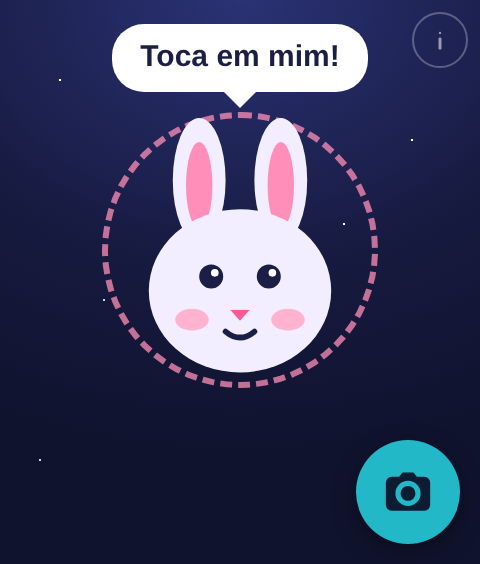

# Kids Explorer (Explorador Curioso)

A Rabbit R1 Creation that lets a child ask questions by voice or with a photo and hear short answers in European Portuguese, spoken by the rabbit on the R1 screen.

## Install on your Rabbit R1

It runs on your own keys: the R1 talks directly to OpenAI (and, optionally, Azure Speech for a Portugal voice), billed to your accounts. There is no server in between.

1. **Get an OpenAI API key** at [platform.openai.com/api-keys](https://platform.openai.com/api-keys), in an account with credit. Create a key just for this and set a spending limit on its project. Optionally, create a free (F0) [Azure Speech](https://learn.microsoft.com/azure/ai-services/speech-service/) resource for the Portugal voice.
2. **Open the [install page](https://jhacarreiro.github.io/kids-explorer/install/)**, paste your keys and generate your QR code. The page has no network access: the keys go only into the QR code.
3. **Install it on the R1.** Open the **Creations** card, go to the **Create** tab, choose **Add via QR code** and scan it ([Rabbit's guide](https://www.rabbit.tech/support/article/how-to-use-r1-creations)).
4. **Start exploring.** Open **Explorador Curioso** from its card. Tap the rabbit to ask a question, or the round camera button to ask about something you can see.

The QR code contains your keys, so treat it like a password: anyone who scans it can spend on your accounts. If it leaks, delete the key at OpenAI and generate a new QR. No account is needed for the child; questions, answers and history stay on the R1 and your own OpenAI account. The small **i** at the top holds the adult settings: the child's age and the history kept on the device.

## How it works

- [`app/`](app/) is the Creation the R1 loads. It answers with `gpt-5.6-luna` through the OpenAI Responses API, transcribes recorded clips with `gpt-4o-mini-transcribe` when the R1 gives no transcript, and speaks with Azure's `pt-PT-RaquelNeural` voice, or the R1's own voice when Azure is not set up.
- [`app/child-contract.js`](app/child-contract.js) holds the prompt every answer is generated with and the rules every answer must meet before the child hears it.
- [`install/`](install/) is the page that builds the installation QR. It runs entirely in the browser and its Content Security Policy blocks all network access.

Keys are kept in the R1's hardware-encrypted creation storage. Opened in an ordinary browser, the Creation keeps them in memory only.

The site is served by GitHub Pages from the `main` branch.

## Third-party code

[`install/qrcode.js`](install/qrcode.js) is [qrcode-generator](https://github.com/kazuhikoarase/qrcode-generator) 1.4.4 by Kazuhiko Arase, MIT licensed; its notice is kept in the file.
